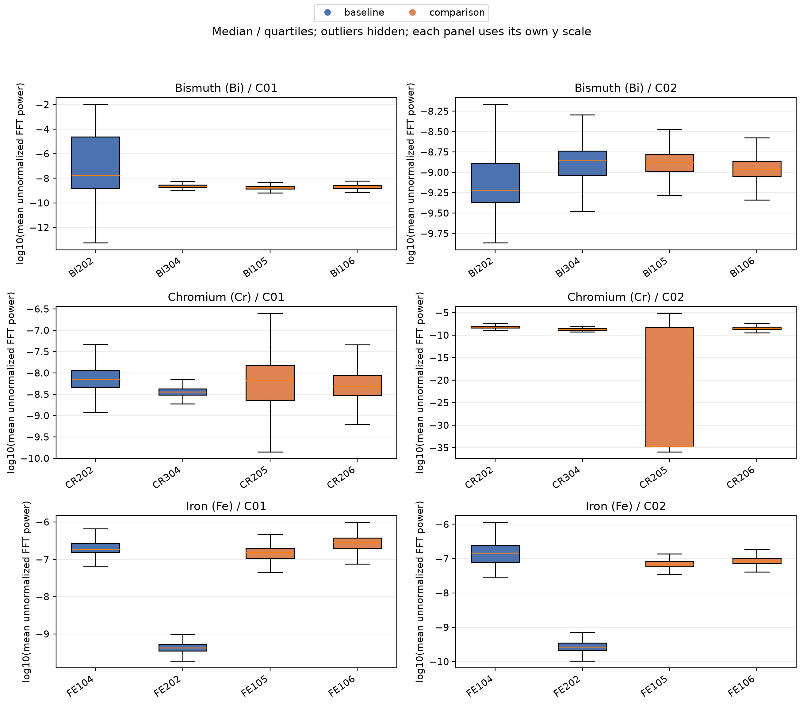
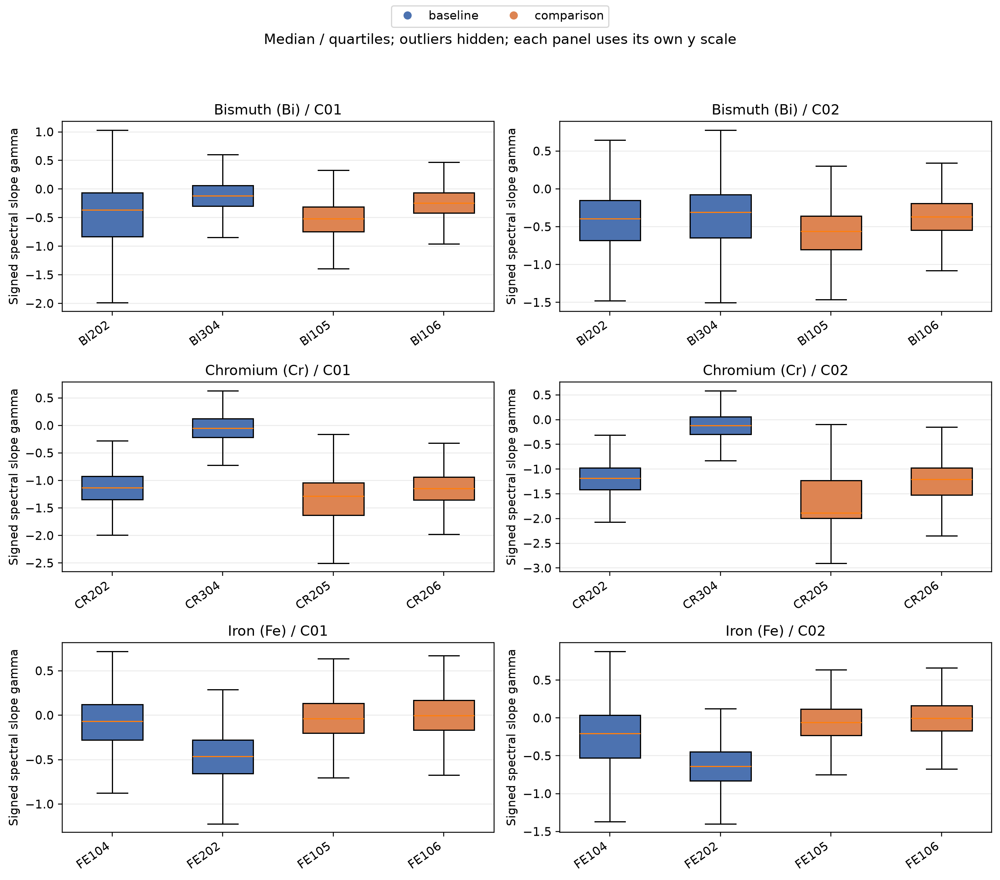
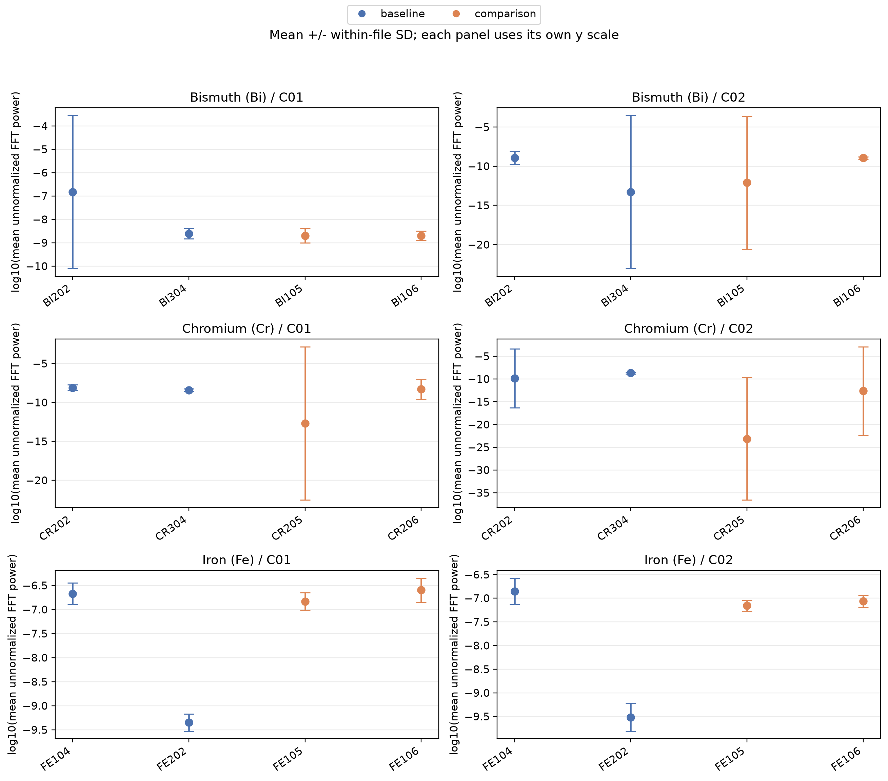
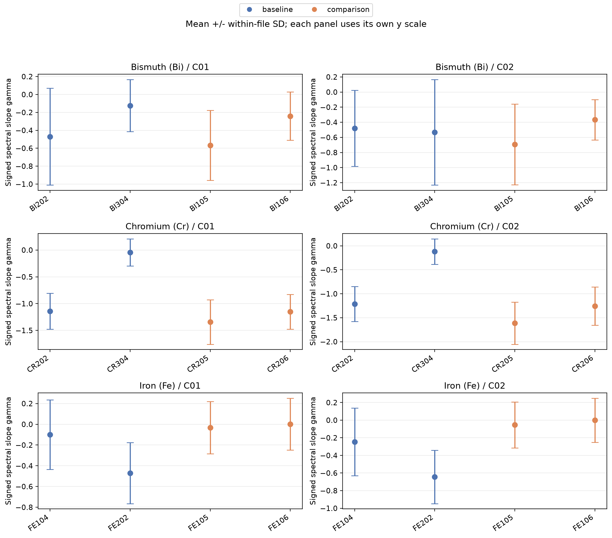
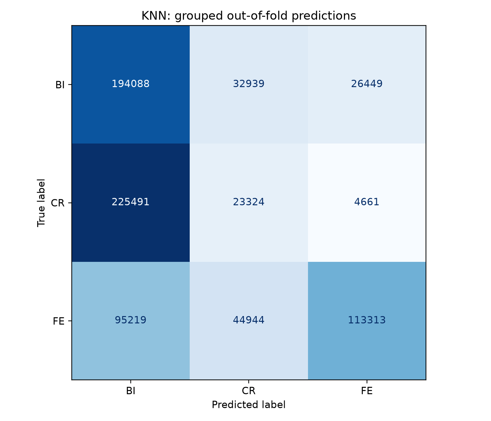
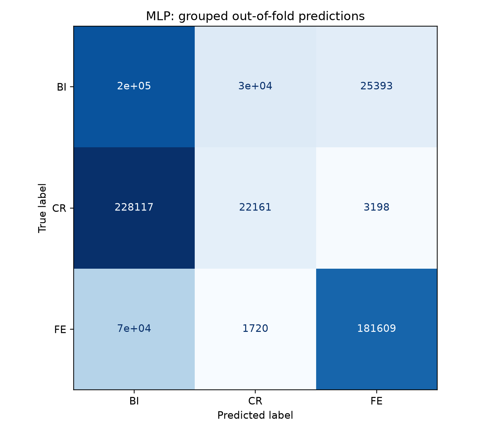

# Conductivity Fluctuation Analysis

Processing of binary Q00 recordings, spectral feature extraction, and group-aware classification of Bi/Cr/Fe thin-film samples.

## Project structure

- `src/dataset_config.py` — central registry of files, channels, and analysis settings.
- `src/signal_processing.py` — reads Q00 recordings and creates processed CSV files.
- `src/train_models.py` — trains and evaluates models, creates summaries and figures.
- `notebooks/01_signal_processing.ipynb` — exploratory signal-processing notebook.
- `notebooks/02_train_models.ipynb` — model-evaluation notebook.
- `build_dataset.py` is unused and is not required.

## Registered data

- 24 Bi/Cr/Fe files: two channels for each of 12 experimental series.
- Six `XXX01C01`–`XXX01C06` files are reference recordings and are not automatically included in model training.
- `CO105C01/C02`, `AL103C01/C02`, and `COB01C01/C02/C03` are exploratory recordings.
- Missing registered files are skipped and marked in `file_inventory.csv`.
- Ag, Pt, and other series are not added automatically because consistent metadata are required.
- Input Q00 files may be placed directly in `data/q00/` or in year-based subfolders.
- Duplicate file names in different subfolders cause an error.

## Labels and limitations

- `baseline` refers to the earlier 2005 Bi/Cr/Fe series and is used as the analytical training base.
- `comparison` refers to the earlier 2006 series. This does not establish an irradiation status.
- `irradiated=None` until confirmed from laboratory records; set `True` or `False` only based on documented evidence.
- `used_for_training` preserves the previous analytical selection but does not establish physical stability.
- If this selection is not supported by laboratory records, the evaluation cannot be interpreted as recognition of stable films.
- `C01` and `C02` for Bi/Cr/Fe are treated as different channels; their operating regimes are unknown.
- For `CO105` and `AL103`, regimes are taken from the provided description: `C01` is unregulated and `C02` is regulated.
- `year` is a label from the original catalogue table, not a calendar year calculated from Julian Date.
- Dates from earlier responses were not transferred because they were not reliably verified.
- `experiment_id` combines channels belonging to the same experimental series. The independence of series and physical samples requires verification.
- If several series belong to the same physical sample, a broader group identifier is required.
- Synchronous campaigns involving different materials may require separate session-based splits.

## Features

- Window length: 128 points.
- Window overlap: 50%.
- Linear trend removal.
- Blackman window.
- Real FFT (`rFFT`).
- `gamma`: signed slope of `log(power)` versus `log(frequency)`.
- `energy`: mean of positive non-zero frequency components of `|FFT|^2`, following the previous implementation. It is not a normalized PSD and not an integrated physical energy.
- `log_energy = log10(energy)`; invalid values are not artificially replaced by a minimum.
- Frequencies in the table are file-level average estimates; constancy of the sampling step within recordings must be verified.
- The CSV files include `experiment_id`, `channel`, `record_index`, `sample_start`, `analysis_role`, `control_mode`, `measurement_type`, and `electrode_distance_mm`.
- Electrode distances for `COB01` are labelled only in `C03`, using record numbers starting from 1.

## Installation and usage

Run the following commands from the project root in PowerShell:

```powershell
python -m venv .venv
.\.venv\Scripts\python.exe -m pip install -r requirements.txt
.\.venv\Scripts\python.exe src/signal_processing.py
.\.venv\Scripts\python.exe src/train_models.py
.\.venv\Scripts\python.exe -m notebook
```

The commands do not require environment activation or changes to the PowerShell execution policy.

Open notebooks from the started Jupyter server and select the kernel associated with the installed environment. After replacing scripts, restart the kernels of previously opened notebooks.

By default, the first notebook loads the existing processed CSV file. Set `REBUILD=True` to reconstruct the dataset.

## Evaluation protocol

- `StratifiedGroupKFold` is used with `experiment_id` as the grouping variable.
- The current configuration uses two folds for the two baseline series of each class.
- Channels from the same experimental series do not appear in both training and test sets.
- `StandardScaler` is fitted within each fold.
- Accuracy is calculated at the window level, not at the level of independent physical samples.
- MLP uses `early_stopping=False`, avoiding a hidden random split of related windows for early stopping.
- After evaluation, the final MLP is trained on all baseline rows.
- Additional materials are not included in the main model.

## Results

### Classification models

Two supervised models, KNN and MLP, were evaluated using the extracted spectral features. The MLP achieved higher overall performance than KNN.

| Model | Accuracy | Balanced accuracy |
|---|---:|---:|
| KNN | 43.49% | — |
| MLP | 52.83% | — |

Per-fold results are available in `results/metrics/model_metrics.csv`.

### KNN classification report

| Class | Precision | Recall | F1-score |
|---|---:|---:|---:|
| BI | 0.377 | 0.766 | 0.505 |
| CR | 0.230 | 0.092 | 0.132 |
| FE | 0.785 | 0.447 | 0.570 |

KNN reached an overall accuracy of 43.49%. It identified the BI class with relatively high recall but performed poorly on the CR class.

### MLP classification report

| Class | Precision | Recall | F1-score |
|---|---:|---:|---:|
| BI | 0.399 | 0.781 | 0.528 |
| CR | 0.410 | 0.087 | 0.144 |
| FE | 0.864 | 0.716 | 0.783 |

The MLP reached an overall accuracy of 52.83%. It showed the strongest performance for the FE class, with precision of 0.864, recall of 0.716, and an F1-score of 0.783. As with KNN, the CR class remained the most difficult to classify.

### Clustering

KMeans clustering produced a silhouette score of 0.556, indicating moderate separation between the identified clusters.

## Figures

### Energy and gamma distributions





### File-level comparison





### Classification results





Figures are separated by material and channel. Panels use independent y-axis scales; compare axis labels carefully.

Error bars represent the standard deviation across windows within a file, not confidence intervals. Box plots hide outliers only for visualization; the underlying data are not removed.

A high predicted class probability does not prove the absence of a radiation-induced effect.

## Output files

- `data/processed/conductivity_features.csv`
- `data/processed/file_inventory.csv`
- `data/processed/*_features.csv`
- `results/metrics/model_metrics.csv` — per-fold classification metrics.
- `results/metrics/evaluation_splits.csv` — group composition.
- `results/metrics/out_of_fold_predictions.csv`
- `results/metrics/knn_classification_report.csv`
- `results/metrics/mlp_classification_report.csv`
- `results/metrics/clustering_metrics.csv` — silhouette score, reported separately from classification accuracy.
- `results/metrics/comparison_film_predictions.csv` — predictions for all windows in comparison series.
- `results/metrics/comparison_file_summary.csv` — one row per file.
- `results/metrics/irradiated_film_predictions.csv` — only confirmed irradiated rows.
- `results/metrics/file_feature_summary.csv`
- `results/figures/knn_confusion_matrix.png`
- `results/figures/mlp_confusion_matrix.png`
- `results/figures/kmeans_clusters.png`
- `results/figures/file_level_gamma_comparison.png`
- `results/figures/file_level_energy_comparison.png`
- `results/figures/gamma_boxplots_by_file.png`
- `results/figures/energy_boxplots_by_file.png`

Old images from previous runs are not automatically removed.

## Before scientific interpretation

The following points must be verified before drawing scientific conclusions:

- Q00 calibration and file structure.
- Operating regimes of the Bi/Cr/Fe channels.
- Independence of samples and experimental series.
- Irradiation statuses and irradiation dates.
- Constancy of the time step within recordings.

The code has been checked syntactically. Processing of the binary files and model training were not run in this delivery.
